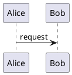

# Plugins and renderer adapters design

## Status

This is the accepted design for Heine's first extension boundary,
Markdown-aware renderer adapters and configured external renderer profiles.
The stream-protocol, workspace-backed embedded-result, generated-resource,
and renderer-cache slices are implemented. Renderer source files and bundles
already live below the watched content tree. Other extension kinds remain
undecided until a separate concrete use case requires them. Package discovery,
installation, and distribution are likewise undecided.

## Decision

Heine will not add generic pre-build or post-build hooks. Its first in-Heine
extension boundary is a renderer adapter: one explicit authored construct or
declared local input produces one checked rendered replacement and, where
requested, one primary generated resource. A site may configure any number of
named renderer profiles. PlantUML, Mermaid, Graphviz DOT, Typst, KaTeX, and
Pandoc are representative uses, not a closed built-in list.

The host retains source discovery, input checking, ordering, output-path
allocation, collision detection, publication, caching, watching, and
diagnostics. An adapter neither mutates Heine's resolved site model nor writes
to `public/` directly.

Structured site facts, render-context extensions, rendered-output
transformations, and a general plugin API are not part of this accepted
boundary. Each needs its own concrete use case and design before it can become
a Heine feature.

## Motivation

An external preprocessor can compile a stylesheet or optimize an image before
Heine starts. It is the right tool when a project simply wants a prepared input
tree. It is not sufficient for an authored Markdown construct such as a
PlantUML diagram: the diagram source should remain in Markdown, while the
rendered page receives a generated SVG and the original source does not need
to be copied, commented out, or manually synchronized.

Generic command hooks would solve that narrow problem by granting far more
authority than it needs. They would blur output ownership, make watch behavior
opaque, and allow a project configuration to execute arbitrary commands merely
because it was built. Renderer adapters instead describe one checked request
and one checked result.

## Terms

- **Plugin**: a possible later in-process extension. It has no accepted public
  API today. If justified, it must receive project-owned serializable views and
  return typed, checked results without direct Tera, output, filesystem, or
  process authority. Its implementation language or runtime remains undecided;
  Rhai is one possible future choice, not a current dependency or
  contract.
- **Renderer adapter**: a content-transformation capability that accepts one
  explicit renderer request and returns one typed replacement and, when
  materialized, one primary generated resource. The first implementation uses
  configured external renderer profiles only.
- **Renderer profile**: one named, site-owned renderer configuration. Its name
  selects a checked adapter request and fixes the external bridge's process
  protocol, arguments, result shape, limits, and cache identity.
- **External renderer bridge**: a trusted host capability used by an adapter
  when an installed external program, such as PlantUML or Typst, must run.
  It is not an ordinary safe plugin and requires explicit command-line
  permission.
- **Placement**: whether a rendered replacement participates in prose or
  occupies its own Markdown block.
- **Materialization**: whether rendered output is embedded in HTML or
  published as a generated resource.
- **Result shape**: the semantic replacement that a renderer profile may
  return: an embedded HTML, SVG, or MathML fragment; a generated image; or a
  generated linked resource.
- **Named renderer source**: a page-owned checked file or source bundle that
  an adapter may consume instead of an inline directive body.

## Ownership and conflicts

For renderer adapters, a request selects exactly one configured renderer
profile. A profile exists when its named configuration exists; there is no
separate enable or disable state. A request for a missing profile is a checked
error. Generated resources are normal output claims with existing collision
diagnostics. When identical renderer bytes share one digest-addressed resource,
that claim retains every Markdown request that produced it. A later collision
therefore identifies every relevant request, not an arbitrary representative.
Profiles have no incidental ordering relationship.

No generic conflict or ordering policy is accepted for unimplemented plugin
kinds. If a future kind is justified, its design must define checked ownership
and overlap behavior before an API exists. Heine will not resolve conflicts by
last-write-wins behavior.

## Renderer-profile configuration

The root `heine.toml` registers external renderer profiles below
`[renderers.<name>]`. A profile name is the simple identifier used in a
Markdown `render` request. The table's presence registers the profile. Heine
does not provide a second enable switch, executable discovery, installation,
package registry, or fallback after ordinary operating-system program
resolution.

A selected kit never contributes profiles at runtime. Its reference site's
`site/heine.toml` may declare profiles for the Markdown that the reference site
contains. Copying that file makes them ordinary root-owned site policy. A later
kit update therefore cannot add, replace, or execute a renderer profile in an
existing site.

Each profile declares its protocol, program, positive timeout, stable cache
identity, accepted input forms, result shape, and one or both placement
variants. A placement variant contains the fixed argument vector for that form.
Its presence declares that the profile supports the corresponding Markdown
placement:

```toml
[renderers.plantuml]
protocol = "stream"
program = "java"
timeout_seconds = 20
cache_identity = "plantuml-1.2025.7"
inputs = ["body", "file"]
result = "svg"
materializations = ["embedded", "resource"]
default_output = "resource"

[renderers.plantuml.block]
arguments = ["-jar", "/opt/plantuml.jar", "--svg", "-pipe"]

[renderers.katex]
protocol = "stream"
program = "katex"
timeout_seconds = 10
cache_identity = "katex-0.16.27"
inputs = ["body", "file"]
result = "html"

[renderers.katex.inline]
arguments = ["--format", "htmlAndMathml"]

[renderers.katex.block]
arguments = ["--display-mode", "--format", "htmlAndMathml"]

[renderers.typst-report]
protocol = "workspace"
program = "typst"
timeout_seconds = 30
cache_identity = "typst-0.15.0"
inputs = ["body", "file", "bundle"]
input_extension = "typ"
result = "link"
media_type = "application/pdf"
extension = "pdf"

[renderers.typst-report.block]
arguments = ["compile", "{input_file}", "{output_file}"]
```

`inputs` is a non-empty set drawn from `"body"`, `"file"`, and `"bundle"`.
A stream profile may accept only `"body"` and `"file"`; a workspace profile
may accept all three. A workspace profile that accepts `"body"` declares the
safe, unprefixed `input_extension` used for its materialized input file. A
workspace profile that does not accept `"body"` must not declare
`input_extension`. A request that supplies an unsupported input form is a
checked error at the request.

`result` is one of `"html"`, `"svg"`, `"mathml"`, `"image"`, or `"link"`.
An `image` or `link` result declares its output `media_type` and file
`extension`; `svg` has the fixed `image/svg+xml` type and `svg` extension.
Only `svg` may declare `materializations`; its values are the supported subset
of `"embedded"` and `"resource"`. An SVG profile with both values must declare
`default_output`; it must not declare one when only one value is supported.
HTML and MathML always embed. Image and link results always publish one
resource. A link profile may therefore produce a PDF without making PDF a
special configuration category.

The profile owns all tool-specific switches. For example, the KaTeX variants
above fix display mode without exposing a Markdown option that could alter the
process invocation. A site that needs a distinct Mermaid theme, Pandoc input
format, or Typst export mode declares another profile with its own fixed
arguments. This keeps the profile registry unbounded without becoming a
Markdown-to-command interpolation language.

The `cache_identity` value is an explicit cache declaration. Heine includes it
in the cache key, but does not probe, discover, or verify the installed
program's version. Arbitrary tools do not provide one reliable version or
environment contract that Heine could check. When a local renderer changes,
the site owner updates `cache_identity` to invalidate cached results
intentionally. A profile may use an absolute program path or a program name
resolved by the operating system when the permitted build runs; Heine never
searches for alternatives.

A profile is checked when Heine reads configuration. Its executable is started
only when a request selects it and the caller has opted in to external
renderers. An absent executable, unsuccessful process, timeout, or invalid
result is then a checked build failure at the selected request. An unused,
valid profile does not require its program to be installed.

The common modes of the first representative tools fit this contract:

| Tool        | Usual protocol and placement      | Result shape                         |
|-------------|-----------------------------------|--------------------------------------|
| PlantUML    | Stream, block                     | SVG, embedded or image resource      |
| Mermaid CLI | Workspace, block                  | SVG or image resource                |
| Typst       | Workspace, block                  | SVG, HTML fragment, or linked PDF    |
| KaTeX       | Stream, inline and block variants | HTML or MathML fragment              |
| Pandoc      | Stream or workspace, block        | One HTML fragment or linked resource |

The table does not reserve these names or make them built in. A profile may
use any name and a supported program may have other modes. A Pandoc conversion
that extracts images alongside an HTML result is not a single-output mode and
therefore remains outside the first result contract. Modes that produce
several primary artifacts remain outside it as well.

KaTeX profiles use explicit `render` requests. They do not change the existing
`markdown.math` modes or introduce another implicit math parser. A later
integration with ordinary TeX delimiters needs its own concrete design.

## Markdown renderer requests

Renderer requests use one `render` concept with forms appropriate to Markdown's
two structural contexts. They do not reuse Tera syntax and do not change the
meaning of ordinary fenced code blocks.

`render` is a distinct adapter request role, not a catch-all directive
registry. A built-in Markdown construct with its own checked contract, such as
the native `:::picture` color-scheme image block, remains owned by Heine and
does not select an adapter.

### Inline role

An inline request has a header and a body delimited by one or more backticks:

```markdown
The integral is :render[katex]`integral_{0}^{1} x^2 dif x`.
```

The header begins with an adapter name, followed by optional named options.
The body is passed unchanged to the adapter. An inline body must stay on one
line. A longer backtick run admits shorter runs inside the body, following
Markdown's code-span convention:

````markdown
:render[katex]``some source with ` inside``
````

### Block directive

A block request starts at the beginning of a line with a run of at least three
colons and ends with an equal or longer colon run on its own line:

```markdown
:::render[plantuml output="resource"]
@startuml
Alice -> Bob: request
Bob --> Alice: response
@enduml
:::
```

An author lengthens the opening and closing colon runs when the body contains
the shorter delimiter:

```markdown
::::render[plantuml output="resource"]
@startuml
note right
:::
end note
@enduml
::::
```

The block form is the only form that may contain line breaks. Nested renderer
requests are not part of the first version. Code spans and fenced code blocks
always suppress renderer-request recognition. In ordinary prose, `\:render`
begins literal text rather than a request.

The syntactic form determines placement:

| Form            | Placement |
|-----------------|-----------|
| Inline role     | Inline    |
| Block directive | Block     |

A renderer profile declares the placements it supports. A PlantUML profile
will normally support blocks only. A KaTeX profile may support both.

An inline-capable profile promises to return phrasing content for that
placement. Heine does not repair trusted renderer markup that would be invalid
inside the surrounding prose. A Pandoc HTML profile will therefore normally be
block-only, while KaTeX is a natural inline-and-block profile.

### Header grammar and options

The header has this shape:

```text
adapter-name (space option-name "=" TOML-scalar)*
```

Renderer and option names are simple identifiers. Option values use TOML scalar
literals, allowing strings, booleans, and numbers without inventing another
value grammar. The first version recognizes only `source`, `output`, `alt`,
and `label`. Tool-specific switches stay fixed in the named renderer profile;
an author selects a separately configured profile when a different tool mode
is needed. A malformed header, duplicate option, or unsupported option is a
checked error at the header span.

`source` and `label` are non-empty strings. `source` names one declared
renderer input and is valid only in a block request. `alt` is a string and may
be empty when an image is intentionally decorative. `output` is a string with
one of the values below. Image resources, including a resource-materialized
SVG, require `alt`; linked resources require `label`.

`output` is the common materialization option:

| Value        | Meaning                                                                                  |
|--------------|------------------------------------------------------------------------------------------|
| `"embedded"` | The profile returns an HTML, SVG, or MathML fragment directly in the rendered page.      |
| `"resource"` | The profile returns one generated resource and a semantic replacement that refers to it. |

A profile declares supported output values and may declare a documented
default. HTML and MathML default to `"embedded"`; image and link results
default to `"resource"`; an SVG profile with both materializations declares
`default_output`. An image resource requires page-authored accessibility text
such as `alt="Request and response sequence"`. A linked resource requires
page-authored visible text such as
`label="Download the architecture report (PDF)"`. Both values are content,
not template interface text.

Placement and materialization are independent. A PlantUML diagram can be a
block in both cases: either an embedded `<svg>` or a generated SVG resource
represented by an image. An HTML or MathML fragment supports only
`output="embedded"`. A PDF is a linked resource with media type
`application/pdf`, so it supports only `output="resource"`.

Ordinary code fences retain their normal meaning. This remains a highlighted
source block, even if a PlantUML adapter is enabled:

````markdown

````

## Renderer inputs

A renderer request consumes exactly one of these checked input forms:

- its inline or block body;
- a named declared file; or
- a named declared source bundle.

Named sources are declared in the owning `.page` file and resolved relative to
that file. A file is one non-published renderer input. A bundle has a checked
root directory and entry file, preserving relative imports for tools such as
Typst without exposing the entire project tree. The proposed shape is:

```toml
[render.architecture]
file = "architecture.puml"

[render.report]
root = "report"
entry = "main.typ"
```

The two forms are mutually exclusive. A named file or bundle is not an
ordinary copied asset or declared template content value. Its path must remain
inside `content/`, reject symbolic links, and not overlap another declared
renderer source or a copied asset. A bundle's entry must be a regular file
beneath its root.

A bundle comprises every regular non-symbolic-link file below its declared
root. Heine walks those files in deterministic relative-path order and uses
the same inventory for workspace copying, watching, and cache hashing. It
does not apply `.gitignore`, VCS, or other implicit ignore rules: omitting a
file that can affect a renderer would make its result stale. An author who has
large unrelated inputs therefore chooses a narrower bundle root.

A request names its source instead of supplying a body:

```markdown
:::render[typst-report source="report" output="resource"]
:::
```

When `source` is present, the directive body must be empty. Inline named
sources are deferred until a concrete use case makes their syntax worthwhile.

## Renderer results and output ownership

A renderer result never contains a project path or output path. It contains
typed facts:

- one result shape: an embedded HTML, SVG, or MathML fragment; an image
  resource; or a linked resource;
- generated-resource bytes, media type, and extension, when requested.

An embedded fragment is trusted final markup. Heine does not sanitize it or
send it through Markdown or Tera a second time. An image resource has an
`image/*` media type and renders as an image with the request's required
alternative text. A linked resource may use any declared media type. PDF is
the common document case, but the same shape can link to an EPUB, DOCX, CSV,
archive, audio file, or video file without inventing a new renderer-result
kind. Heine does not initially render generated audio or video with native
players: captions, transcripts, posters, controls, and fallback content need a
separate concrete design.

Heine checks the result shape before rendering it. Every returned result must
contain non-empty bytes. HTML fragments must be UTF-8. SVG and MathML
fragments must be UTF-8 XML whose document element is respectively `svg` or
`math`. An image profile declares a syntactically valid `image/*` media type;
a link profile declares a syntactically valid media type. Every declared file
extension is an unprefixed safe filename extension. These checks identify a
wrong result category or malformed bridge configuration; they do not sanitize
trusted HTML or inspect arbitrary resource formats.

For embedded SVG and MathML, Heine parses the XML and emits only its document
element. It drops an XML declaration and doctype rather than inserting a whole
XML document into HTML. For resource materialization, Heine publishes the
validated bytes unchanged. Heine does not rewrite element IDs, URL references,
CSS, scripts, or HTML markup. An embedded profile must therefore produce a
fragment that is safe for its declared placement and does not conflict with
the surrounding page. A resource profile is the appropriate choice when a
renderer cannot make that promise.

The XML transformation uses an event-based parser and writer, never textual
replacement. It preserves element structure, text, CDATA, comments, processing
instructions, and namespace declarations while omitting only declaration and
doctype events. This keeps declaration removal from changing unrelated XML
content.

The first implementation accepts one primary generated resource per request.
Tools can produce several files in some modes, for example a multi-page Typst
SVG export, a PlantUML input containing several diagrams, or a Pandoc
conversion with extracted media. Those modes fail as unsupported until a later
resource-set contract can define their page replacement and ownership.

Heine allocates safe deterministic output paths for generated resources, checks
them with every other output claim, and builds base-path-aware URLs. The
adapter cannot overwrite a page, copied asset, deployment file, license text,
or another generated resource.

Generated renderer resources publish below the root-level
`heine-renderers/` namespace. Heine reserves that namespace for this result
kind: pages, copied assets, deployment files, license texts, and configured
generated resources cannot claim paths below it. It remains separate from
`__heine/`, which the development server owns and never publishes as site
output. A renderer resource uses its validated returned bytes to derive a
base-path-aware path of this form:

```text
heine-renderers/sha256-<full-output-digest>.<declared-extension>
```

The full SHA-256 digest identifies the returned bytes, not the renderer cache
key. A refreshed renderer that returns different bytes therefore receives a
new public URL even when its declared input and cache key did not change.
Requests with the same returned bytes and extension share one generated output
file.

A full build stages only the current resolved renderer-resource inventory, then
atomically replaces the managed output tree. When a refreshed renderer returns
different bytes, the superseded digest file therefore disappears with the
previous output tree; public renderer resources need no separate garbage
collector.

A generated renderer resource is not a copied asset. It has no adjacent
licensing sidecar and is outside the current `[licensing].required` coverage
contract, which applies to copied assets only. A future policy for generated
resource licensing needs a separate provenance design: relevant facts may come
from the authored renderer source, the renderer, bundled fonts, or other tool
inputs. Heine does not infer those facts.

The host retains the originating page, content file, directive span, and
renderer-profile name for every derived resource. An attempted authored claim
inside `heine-renderers/` therefore identifies its source, while diagnostics
for a renderer failure can identify every affected request.

## External renderer bridges

The first implementation runs configured external renderer profiles. PlantUML,
Typst, KaTeX, Pandoc, Mermaid, Graphviz, and many other renderers require
external programs. That is a distinct trust boundary: a child process runs
with the operating-system authority of the user who starts Heine. A temporary
workspace limits the inputs Heine provides, but is not a sandbox against a
malicious executable. A future in-process renderer needs its own concrete
design or should become a native Heine feature.

A renderer profile is trusted in two distinct ways. Its program and any wrapper
script have the process authority of the Heine invocation, which is broader
than a template's authority. An embedded HTML, SVG, or MathML result has the
same browser-output authority as trusted project templates: it can contribute
arbitrary markup, including active content. Do not configure a renderer
program, wrapper, or embedded-result profile that the site owner would not
trust with those respective authorities.

Heine must therefore require an explicit command-line opt-in before it starts
an external bridge, conceptually `--allow-external-renderers`. A site
configuration alone must never execute a command from an unfamiliar checkout.
The opt-in applies to `heine` and `heine serve` separately.

When a selected renderer request needs an external profile and that permission
is absent, the build fails at the request before it reads a renderer cache or
starts a process. A cached result is an optimization after permission has been
granted, not an alternate way to build a site that requires an external
renderer. This makes a fresh checkout and a workspace with old cached output
follow the same permission rule. Configured profiles that no request selects
remain harmless and need neither permission nor an installed program.

An external bridge is not a generic hook. It may run only for a checked
renderer request and returns only the typed result described above. Uploading,
deployment, remote fetching, generic task orchestration, and arbitrary
pre-build or post-build commands remain outside Heine.

### Process protocols

The host supports two profile-declared protocols.

#### Stream protocol

Heine writes the checked source bytes to standard input and reads one typed
result from standard output. Standard error is reserved for diagnostics. This
suits tools that can act as filters, including PlantUML, KaTeX, and Pandoc.

#### Workspace protocol

Heine assigns each serialized workspace profile one isolated reusable workspace
slot with this layout:

```text
input/
output/
work/
```

It copies the checked named file or source bundle below `input/`, preserving
relative paths, and materializes an inline body as `input/input.<extension>`.
The profile supplies that extension. It invokes the configured program with
`work/` as its current directory. The host allocates one primary output file
below `output/`; only that file can become the result.

The implementation uses a cross-platform temporary-directory facility, such
as Rust's `tempfile` crate, and native `OsString` process arguments. It must
not build shell command strings. Program and argument vector entries stay
separate. A workspace variant may use only these complete argument
placeholders:

| Placeholder     | Value                                                              |
|-----------------|--------------------------------------------------------------------|
| `{input_file}`  | The checked named file, bundle entry, or materialized inline body. |
| `{input_dir}`   | The root of the checked input file or source bundle.               |
| `{output_file}` | The host-allocated primary result file.                            |
| `{work_dir}`    | The request-local working directory.                               |

Placeholders never expand inside another argument. A workspace variant uses
`{output_file}` exactly once and may use every other placeholder at most once.
This preserves paths containing spaces or non-ASCII text on Windows, Linux,
and macOS without creating a command-templating language.

This rule deliberately does not support dynamic joined arguments such as
`--output={output_file}`. A renderer that requires that command shape needs a
site-owned wrapper script. That wrapper remains an explicit external bridge
and therefore runs only with external-renderer permission.

An external bridge may invoke a user-authored executable shell script or
batch-file wrapper when the user has granted external-renderer permission.
Platform-specific wrappers are expected where a renderer itself is
platform-specific. For example, a Windows bridge may invoke
`cmd.exe` with a batch file as distinct arguments, while an Unix-like bridge
may invoke an executable script directly. Heine itself does not add an
implicit shell layer.

The host clears the slot before staging an input, captures bounded standard
error, checks the exit status, and reads and checks the primary output file
before it cleans the workspace again. Extra files
below `output/` are a checked error, not incidental publication. A cleanup
failure after successful result capture does not invalidate that complete
result. Heine reports the retained workspace path for recovery, which
accommodates temporary file locks on Windows without turning them into a false
rendering failure.

### Execution limits and workspace retention

Every external bridge declares a positive maximum duration for one renderer
request. There is no unbounded default. A renderer that needs more time must
ask for it explicitly in its bridge configuration. When the duration expires,
Heine stops waiting, attempts to terminate the direct child process, and fails
the request at its authored location while retaining the last complete output.

Terminating a direct child is portable. Reliably terminating arbitrary
descendant process trees is not a cross-platform guarantee without additional
platform-specific supervision. A trusted bridge that starts child processes
must therefore manage them through its own wrapper; Heine reports the timeout
and any retained workspace path without claiming to have contained those
children.

The host creates a session-owned renderer-workspace parent below the operating
system temporary directory. Each serialized renderer profile uses one reusable
workspace slot below that parent. A successfully cleaned slot is reused. A
slot that remains locked is unavailable until cleanup succeeds. Heine retries
that cleanup before the next request. If it still cannot clean the slot, Heine
fails the request with the affected path instead of creating unbounded
temporary directories. At process startup, it makes a best-effort sweep of
stale, clearly Heine-owned workspace parents.

## Caching, watching, and failure behavior

The cache applies to every successful renderer result. Its key includes:

- renderer-profile name, `cache_identity`, and normalized configuration;
- the selected placement variant and normalized directive options;
- materialization;
- the input form and its checked representation: inline or block body bytes;
  a named file's bytes; or every checked relative path and byte sequence in a
  named source bundle.

The explicit `cache_identity` represents the selected renderer version or
other cache-relevant tool identity. Heine can make publication deterministic
for returned bytes, but cannot promise reproducibility for an arbitrary
external program whose environment may influence output. The site owner must
change `cache_identity` after changing that program. This responsibility is
intentional: generic version probing or executable fingerprints would not
reliably account for each tool's dependencies and environment.

A cache entry stores the checked typed result and an integrity hash of its
returned bytes. Heine verifies that hash before reusing an entry. A missing,
partial, or corrupt entry is a cache miss, so the host runs the selected
renderer after external-renderer permission has been granted. This integrity
check detects cache corruption; it cannot establish that an external renderer
would return different bytes for unchanged Heine-visible inputs.

`--refresh-renderers` bypasses reusable entries for every selected request. It
runs the selected renderer, validates its result, and writes the refreshed
entry for that request's existing cache key. It does not need to delete older
content-addressed entries: they cannot affect a request unless its exact prior
key recurs. The cache removes incomplete companion files left by interrupted
atomic writes when a renderer build session starts. It does not scan the
complete cache for every request or evict valid entries automatically. Complete
entries remain disposable private working state.

Renderer cache entries live below the site root at
`.heine/cache/renderers/v1/`. This is private, disposable Heine working state,
not published output or authored content. The host writes entries atomically.
Heine does not modify a site's `.gitignore`; documentation recommends ignoring
the `.heine/` directory.

Renderer inputs participate in full builds, development-server watching, and
future dependency-aware incremental builds. Renderer execution is serialized
with the synchronous build pipeline. A renderer failure is a build failure at
the relevant directive, source declaration, or input source span. It includes
the renderer profile name, exit status where relevant, and bounded standard
error. A failed build leaves the previous complete output available.

Renderer-source, renderer-profile, and renderer-configuration changes require
a full build to update relationships and remove superseded generated output.
Quick builds may re-render an already-resolved request whose present source
changes, but they must not claim completeness for those structural changes. A
quick build may also retain an unreferenced superseded renderer resource until
the next full build, just as it retains other stale managed output.

`--refresh-renderers` requires `--allow-external-renderers` when a selected
profile is external. Normal cached builds remain suitable for local iteration.
A refreshed full build verifies the actual configured tools and is the required
release and kit-reference-site test path.

## Rejected alternatives

### Generic pre-build and post-build hooks

They can prepare inputs or process deployment artifacts outside Heine, but
they cannot retain a checked relationship between one Markdown construct and
one generated result. Inside Heine, they would also bypass output ownership and
make a configuration file an implicit arbitrary-code execution mechanism.

### Publishing an arbitrary renderer output directory

One Markdown request needs one semantic replacement in the rendered page. An
unstructured output directory does not say whether its files form a gallery, a
download, a standalone document, or an HTML application with auxiliary
resources. The first bridge therefore accepts one primary generated resource.
A later resource-set result may be justified, but it must define that
replacement, relative-resource behavior, output ownership, and collision
diagnostics before it publishes several files.

### Rewriting embedded renderer markup

Rewriting SVG IDs, URL references, CSS, scripts, or arbitrary HTML would make
Heine responsible for tool-specific markup semantics and can silently change a
renderer result. Parsing XML only to remove the document wrapper has a narrow,
defined purpose. A profile that needs stronger isolation publishes a resource
instead of embedded markup.

### Reusing ordinary language fences

Treating every `plantuml` fence as a diagram would silently change the meaning
of ordinary source-code examples. The `render` role and directive preserve
normal highlighting and make renderer intent visible.

### Reusing Tera syntax in Markdown

Tera syntax belongs to templates. Reusing it for Markdown renderer requests
would make literal documentation confusing and blur two distinct languages.

### A Typst-specific dollar-delimiter mode

Typst distinguishes inline and block equations by whitespace immediately
inside `$` delimiters, while pulldown-cmark's math events follow TeX-style
single- and double-dollar rules. A generic renderer request expresses placement
without asking Markdown to guess Typst semantics. It also applies to more than
math.

### Passing project paths to adapters

Raw paths grant undeclared filesystem access and make dependencies invisible to
the watcher and cache. Named files and source bundles keep the input boundary
inspectable.

### Treating temporary workspaces as a security sandbox

An external executable retains the authority of the operating-system user.
Temporary workspaces improve input discipline and portability, but cannot
confine an untrusted program across supported platforms.

## Implementation acceptance criteria

An implementation must include focused and fixture-site coverage for:

- profile registration and configuration: absent profiles, malformed profiles,
  profile names, no separate enable state, fixed placement variants, result
  shapes, input forms, media types, extensions, cache identities, and unused
  profiles whose unavailable programs are not invoked;
- inline and block request parsing, literal escaping, longer delimiters, and
  code-span and code-fence suppression;
- header, standard options, placement, output-mode, required `alt` and
  `label`, body, nesting, and profile-capability diagnostics with source spans;
- single-adapter selection and generated-resource claims rejecting output
  collisions rather than applying last-write-wins behavior;
- ordinary code-fence highlighting remaining unchanged;
- checked named file and source-bundle discovery, path containment, symbolic
  links, overlapping declarations, and non-publication;
- trusted embedded HTML, SVG, and MathML fragments; image and linked-resource
  results; result-shape validation; event-based XML declaration and doctype
  removal that preserves CDATA and processing instructions for embedded XML;
  unchanged resource bytes; one-primary-resource enforcement; output
  collisions; base paths; locale routes; integrity interactions; and atomic
  publication;
- generated-resource licensing remaining outside copied-asset coverage;
- stream and workspace bridge execution, argument boundaries, paths containing
  spaces and non-ASCII text, complete-placeholder substitution, output escape
  attempts, extra outputs, output capture, and bounded diagnostic text,
  timeouts, and direct-child termination attempts;
- explicit external-renderer permission for normal and development-server
  builds, including a configured renderer that cannot run until a request
  selects it, selected requests that fail before cache lookup without
  permission, and unused profiles that need neither permission nor a program;
- cache-key behavior, streamed bundle hashing, source-bundle watcher behavior,
  locked workspace-slot exhaustion, stale-workspace cleanup, failed renderers,
  refreshed builds, and previous-output preservation;
- public documentation, reference, tutorial, glossary, and a
  starter-site example.
