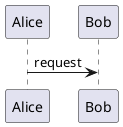

# Plugins and renderer adapters design

## Status

This is the accepted architectural direction for a future Heine extension
system. It is not implemented and is not part of the current public contract.
It records the first concrete use case, Markdown-aware rendering, and the
boundaries that any later implementation must preserve. Package discovery,
installation, and distribution remain deliberately undecided until a second
concrete extension use case requires them.

## Decision

Heine will not add generic pre-build or post-build hooks. An in-Heine
extension must start from an explicit authored construct or declared local
input and return one of these host-owned results:

- a checked rendered replacement;
- a structured site fact in a declared namespace; or
- a generated-resource description.

The host retains source discovery, input checking, ordering, output-path
allocation, collision detection, publication, caching, watching, and
diagnostics. Extensions neither mutate Heine's resolved site model nor write
to `public/` directly.

The first concrete extension use case is a renderer adapter. It keeps an
authored diagram, mathematical expression, or document source unchanged while
producing a rendered replacement and, where requested, a generated resource.
PlantUML, Mermaid, Graphviz DOT, and Typst are representative uses.

## Motivation

An external preprocessor can compile a stylesheet or optimize an image before
Heine starts. It is the right tool when a project simply wants a prepared input
tree. It is not sufficient for an authored Markdown construct such as a
PlantUML diagram: the diagram source should remain in Markdown, while the
rendered page receives a generated SVG and the original source does not need
to be copied, commented out, or manually synchronized.

Generic command hooks would solve that narrow problem by granting far more
authority than it needs. They would blur output ownership, make watch behavior
opaque, and allow a project configuration to execute arbitrary commands merely
because it was built. Renderer adapters instead describe one checked request
and one checked result.

## Terms

- **Plugin**: a future in-process extension that receives project-owned
  serializable views and returns typed, patch-based results. It has no direct
  Tera, output, filesystem, or process authority. Its implementation language
  or runtime is intentionally undecided; Rhai is one possible future choice,
  not a current dependency or contract.
- **Renderer adapter**: a content-transformation capability that accepts one
  explicit renderer request and returns a typed replacement and optional
  generated resources.
- **External renderer bridge**: a trusted host capability used by an adapter
  when an installed external program, such as PlantUML or Typst, must run.
  It is not an ordinary safe plugin and requires explicit command-line
  permission.
- **Placement**: whether a rendered replacement participates in prose or
  occupies its own Markdown block.
- **Materialization**: whether rendered output is embedded in HTML or
  published as a generated resource.
- **Named renderer source**: a page-owned checked file or source bundle that
  an adapter may consume instead of an inline directive body.

## Extension stages

Only content transformation has a concrete use case and a design today. The
host may later need boundaries resembling these stages:

1. content transformation;
2. site transformation;
3. render-context extension; and
4. rendered-output transformation.

The renderer-adapter use case belongs to content transformation. These later
stage names are provisional, not a committed public pipeline or registration
API. If a later stage is justified, it may consume only deliberate output from
an earlier one. No stage receives a mutable internal site structure, direct
Tera access, or output-writing authority.

## Ownership and conflicts

Heine never resolves extension conflicts by last-write-wins behavior.

- A plugin that returns structured site facts owns one declared namespace. Two
  plugins cannot claim the same namespace.
- A renderer request selects exactly one adapter.
- Generated resources are normal output claims and use the existing collision
  diagnostics.
- A future rendered-output transformation must claim each exact target it may
  replace. Overlapping claims are a checked error naming both extensions.

This makes same-stage operations independent of incidental registration order.
Ordering is relevant only when a deliberately designed later stage consumes
the checked output of an earlier one.

## Markdown renderer requests

Renderer requests use one `render` concept with forms appropriate to Markdown's
two structural contexts. They do not reuse Tera syntax and do not change the
meaning of ordinary fenced code blocks.

### Inline role

An inline request has a header and a body delimited by one or more backticks:

```markdown
The integral is :render[typst output="embedded"]`integral_{0}^{1} x^2 dif x`.
```

The header begins with an adapter name, followed by optional named options.
The body is passed unchanged to the adapter. An inline body must stay on one
line. A longer backtick run admits shorter runs inside the body, following
Markdown's code-span convention:

````markdown
:render[typst output="embedded"]``some source with ` inside``
````

### Block directive

A block request starts at the beginning of a line with a run of at least three
colons and ends with an equal or longer colon run on its own line:

```markdown
:::render[plantuml output="resource"]
@startuml
Alice -> Bob: request
Bob --> Alice: response
@enduml
:::
```

An author lengthens the opening and closing colon runs when the body contains
the shorter delimiter:

```markdown
::::render[plantuml output="resource"]
@startuml
note right
:::
end note
@enduml
::::
```

The block form is the only form that may contain line breaks. Nested renderer
requests are not part of the first version. Code spans and fenced code blocks
always suppress renderer-request recognition. In ordinary prose, `\:render`
begins literal text rather than a request.

The syntactic form determines placement:

| Form | Placement |
|---|---|
| Inline role | Inline |
| Block directive | Block |

An adapter declares the placements it supports. A PlantUML adapter will
normally support blocks only. A Typst math adapter may support both.

### Header grammar and options

The header has this deliberately small shape:

```text
adapter-name (space option-name "=" TOML-scalar)*
```

Adapter and option names are simple identifiers. Option values use TOML scalar
literals, allowing strings, booleans, and numbers without inventing another
value grammar. A malformed header, duplicate option, or unsupported option is
a checked error at the header span.

`output` is the common materialization option:

| Value | Meaning |
|---|---|
| `"embedded"` | The adapter returns an HTML or SVG replacement directly embedded in the rendered page. |
| `"resource"` | The adapter returns one or more generated resources and a semantic replacement that refers to them. |

An adapter declares supported output values and may declare a documented
default. Other named options belong to that adapter's checked schema. For an
image-like replacement, an adapter may require page-authored accessibility
text such as `alt="Request and response sequence"`; it is content, not
template interface text.

Placement and materialization are independent. A PlantUML diagram can be a
block in both cases: either an embedded `<svg>` or a generated SVG resource
represented by an image or link.

Ordinary code fences retain their normal meaning. This remains a highlighted
source block, even if a PlantUML adapter is enabled:

````markdown

````

## Renderer inputs

A renderer request consumes exactly one of these checked input forms:

- its inline or block body;
- a named declared file; or
- a named declared source bundle.

Named sources are declared in the owning `.page` file and resolved relative to
that file. A file is one non-published renderer input. A bundle has a checked
root directory and entry file, preserving relative imports for tools such as
Typst without exposing the entire project tree. The proposed shape is:

```toml
[render.architecture]
file = "architecture.puml"

[render.report]
root = "report"
entry = "main.typ"
```

The two forms are mutually exclusive. A named file or bundle is not an
ordinary copied asset or declared template content value. Its path must remain
inside `content/`, reject symbolic links, and not overlap another declared
renderer source or a copied asset. A bundle's entry must be a regular file
beneath its root.

A request names its source instead of supplying a body:

```markdown
:::render[typst source="report" output="resource"]
:::
```

When `source` is present, the directive body must be empty. Inline named
sources are deferred until a concrete use case makes their syntax worthwhile.

## Renderer results and output ownership

An adapter never returns a project path or output path. It returns typed facts:

- replacement kind, such as embedded fragment, image, link, or download;
- generated-resource bytes and media type, when requested;
- optional adapter-owned metadata needed to render that replacement.

Heine allocates safe deterministic output paths for generated resources, checks
them with every other output claim, and builds base-path-aware URLs. The
adapter cannot overwrite a page, copied asset, deployment file, license text,
or another generated resource. Embedded output is final trusted HTML or SVG;
Heine does not send it through Markdown or Tera a second time.

The host must retain the originating page, content file, directive span, and
adapter identity for every derived resource. Any output collision therefore
names both the generated request and the conflicting authored claim.

## External renderer bridges

Some adapters can run wholly in process. PlantUML, Typst, Graphviz, and many
other useful renderers normally require external programs. That is a distinct
trust boundary: a child process runs with the operating-system authority of
the user who starts Heine. A temporary workspace limits the inputs Heine
provides, but is not a sandbox against a malicious executable.

Heine must therefore require an explicit command-line opt-in before it starts
an external bridge, conceptually `--allow-external-renderers`. A site
configuration alone must never execute a command from an unfamiliar checkout.
The opt-in applies to `heine` and `heine serve` separately.

An external bridge is not a generic hook. It may run only for a checked
renderer request and returns only the typed result described above. Uploading,
deployment, remote fetching, generic task orchestration, and arbitrary
pre-build or post-build commands remain outside Heine.

### Process protocols

The host supports two adapter-declared protocols.

#### Stream protocol

Heine writes the checked source bytes to standard input and reads one declared
result from standard output. Standard error is reserved for diagnostics. This
suits tools that can act as filters.

#### Workspace protocol

Heine creates an isolated per-request temporary workspace with this layout:

```text
input/
output/
work/
```

It copies the checked named file or source bundle below `input/`, preserving
relative paths, and materializes an inline body as an adapter-defined input
file. It invokes the configured program with `work/` as its current directory.
Only files below `output/` can become adapter results.

The implementation uses a cross-platform temporary-directory facility, such
as Rust's `tempfile` crate, and native `OsString` process arguments. It must
not build shell command strings. Program and argument vector entries stay
separate, and only complete argument placeholders such as `{input}`,
`{output}`, and `{work}` are substituted. This preserves paths containing
spaces or non-ASCII text on Windows, Linux, and macOS.

An external bridge may invoke a user-authored executable shell script or
batch-file wrapper when the user has granted external-renderer permission.
Platform-specific wrappers are expected where a renderer itself is
platform-specific. For example, a Windows bridge may deliberately invoke
`cmd.exe` with a batch file as distinct arguments, while an Unix-like bridge
may invoke an executable script directly. Heine itself does not add an
implicit shell layer.

The host captures bounded standard error, checks the exit status, and reads and
checks declared output files before it cleans the workspace. A cleanup failure
after successful result capture does not invalidate that complete result. Heine
reports the retained workspace path for recovery, which accommodates temporary
file locks on Windows without turning them into a false rendering failure.

### Execution limits and workspace retention

Every external bridge declares a positive maximum duration for one renderer
request. There is no unbounded default. A renderer that needs more time must
ask for it explicitly in its bridge configuration. When the duration expires,
Heine stops waiting, attempts to terminate the direct child process, and fails
the request at its authored location while retaining the last complete output.

Terminating a direct child is portable. Reliably terminating arbitrary
descendant process trees is not a cross-platform guarantee without additional
platform-specific supervision. A trusted bridge that starts child processes
must therefore manage them through its own wrapper; Heine reports the timeout
and any retained workspace path without claiming to have contained those
children.

The host creates a session-owned renderer-workspace parent below the operating
system temporary directory. Each serialized adapter uses a small fixed number
of reusable workspace slots below that parent. A successfully cleaned slot is
reused. A slot that remains locked is unavailable until cleanup succeeds. If
all slots for an adapter are unavailable, Heine fails the next request with the
affected paths instead of creating unbounded temporary directories. At process
startup, it makes a best-effort sweep of stale, clearly Heine-owned workspace
parents.

## Caching, watching, and failure behavior

The cache key for a renderer result includes:

- adapter identity and version;
- normalized adapter configuration and directive options;
- placement and materialization;
- inline body bytes, or every checked relative path and file byte sequence in
  a named source bundle; and
- a declared external-tool version when a bridge uses one.

An external bridge whose tool version cannot be declared must opt out of
persistent caching. Heine can make publication deterministic for returned
bytes, but cannot promise reproducibility for an arbitrary external program
whose environment may influence output.

Hashing every bundle file is a deliberate correctness-over-speed choice: file
metadata alone is not a reliable cache identity across filesystems, copies, or
coarse timestamp resolutions. The implementation streams file bytes into the
cache hash and does not retain bundle contents merely to compute that key.

Renderer inputs participate in full builds, development-server watching, and
future dependency-aware incremental builds. Renderer execution is serialized
with the synchronous build pipeline. A renderer failure is a build failure at
the relevant directive, source declaration, or input source span; it includes
the adapter identity, exit status where relevant, and useful bounded standard
error. A failed build leaves the previous complete output available.

Quick builds must not claim completeness for renderer-source or renderer-
configuration changes until their dependency behavior is designed explicitly.

## Rejected alternatives

### Generic pre-build and post-build hooks

They can prepare inputs or process deployment artifacts outside Heine, but
they cannot retain a checked relationship between one Markdown construct and
one generated result. Inside Heine, they would also bypass output ownership and
make a configuration file an implicit arbitrary-code execution mechanism.

### Reusing ordinary language fences

Treating every `plantuml` fence as a diagram would silently change the meaning
of ordinary source-code examples. The `render` role and directive preserve
normal highlighting and make renderer intent visible.

### Reusing Tera syntax in Markdown

Tera syntax belongs to templates. Reusing it for Markdown renderer requests
would make literal documentation confusing and blur two distinct languages.

### A Typst-specific dollar-delimiter mode

Typst distinguishes inline and block equations by whitespace immediately
inside `$` delimiters, while pulldown-cmark's math events follow TeX-style
single- and double-dollar rules. A generic renderer request expresses placement
without asking Markdown to guess Typst semantics. It also applies to more than
math.

### Passing project paths to adapters

Raw paths grant undeclared filesystem access and make dependencies invisible to
the watcher and cache. Named files and source bundles keep the input boundary
inspectable.

### Treating temporary workspaces as a security sandbox

An external executable retains the authority of the operating-system user.
Temporary workspaces improve input discipline and portability, but cannot
confine an untrusted program across supported platforms.

## Implementation acceptance criteria

An implementation must include focused and fixture-site coverage for:

- inline and block request parsing, literal escaping, longer delimiters, and
  code-span and code-fence suppression;
- header, option, placement, output-mode, body, nesting, and adapter-capability
  diagnostics with source spans;
- declared plugin namespaces, single-adapter selection, generated-resource
  claims, and future transformation-claim conflicts rejecting overlaps rather
  than applying last-write-wins behavior;
- ordinary code-fence highlighting remaining unchanged;
- checked named file and source-bundle discovery, path containment, symbolic
  links, overlapping declarations, and non-publication;
- embedded and generated-resource results, output collisions, base paths,
  locale routes, integrity interactions, and atomic publication;
- stream and workspace bridge execution, argument boundaries, paths containing
  spaces and non-ASCII text, output escape attempts, output capture, and
  bounded diagnostic text, timeouts, and direct-child termination attempts;
- explicit external-renderer permission for normal and development-server
  builds;
- cache-key behavior, streamed bundle hashing, source-bundle watcher behavior,
  locked workspace-slot exhaustion, stale-workspace cleanup, failed renderers,
  and previous-output preservation;
- public documentation, reference, tutorial, glossary, and a natural
  starter-site example.
